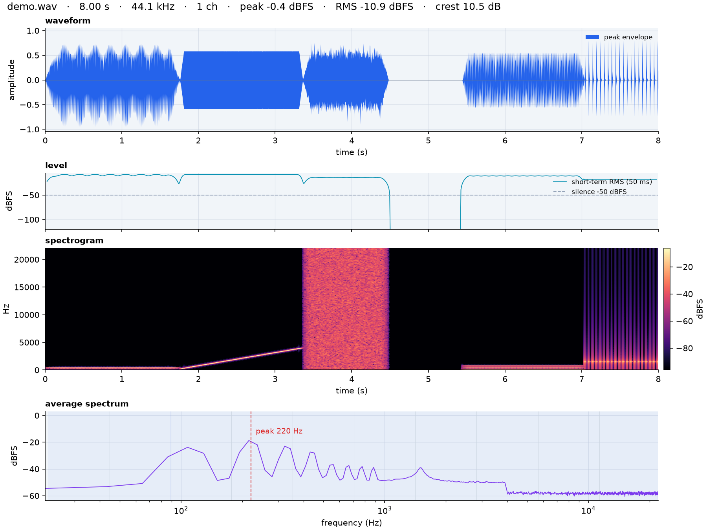

# numpywave

Audio waveform analysis with numpy and matplotlib: levels, silence, spectrum,
octave bands and a four-panel overview — no scipy.



The picture above is produced by `examples/demo.py` (a synthetic signal with a
chord, a chirp, a noise burst, silence, harmonics and a click train).

## Quick start

```bash
uv sync

# analyse a file (text report only)
uv run numpywave examples/demo.wav

# text report + overview PNG next to the file (demo_analysis.png)
uv run numpywave track.flac --plot

# explicit outputs, capped frequency range for the plots
uv run numpywave track.flac --plot out.png --json out.json --fmax 12000

# same thing without the console script
uv run python -m numpywave track.flac --plot
```

`examples/demo.py` regenerates `examples/demo.wav` and the overview image:
`uv run python examples/demo.py`.

### Options

| Option | Meaning |
| --- | --- |
| `--plot [PNG]` | Write the 4-panel overview; default name `<audio>_analysis.png` |
| `--json [FILE]` | Write the scalar summary as JSON; `-` prints only the JSON to stdout (progress messages go to stderr) |
| `--frame N` | STFT frame size (default 2048) |
| `--hop N` | STFT hop size (default `frame / 4`) |
| `--window {hann,hamming,blackman,rect}` | Analysis window (default hann) |
| `--fmax HZ` | Upper frequency limit for the spectrogram and spectrum |
| `--silence-db DB` | Silence threshold in dBFS (default -50) |
| `--dynamic-range-db DB` | Spectrogram colour range (default 90 dB) |
| `--cmap NAME` | Spectrogram colormap (default magma) |
| `--dpi N` | PNG resolution (default 150) |
| `--no-bands` | Hide the octave band table |
| `--show` | Open an interactive matplotlib window |

### Example report

```text
numpywave - waveform analysis
file          : examples\demo.wav
container     : WAV / PCM_16
duration      :    8.000 s   samples: 352800   rate: 44100 Hz   channels: 1

level
  peak          :    -0.45 dBFS   (0.9500)
  rms           :   -10.90 dBFS   (0.2851)
  crest factor  :    10.45 dB
  dc offset     :  +0.00007
  clipped       :        0 samples above 0.999
  zero crossings:    0.0952 per sample
  dynamic range :    10.89 dB   (p95 - p10, non-silent)
  silence       :   11.56 %   below -50 dBFS

spectrum
  dominant      :    220.3 Hz   (-18.4 dBFS)
  centroid      :   1660.4 Hz
  rolloff 85%   :   3036.2 Hz
  flatness      :   0.1181   (0 = tonal, 1 = noise)

octave bands (dBFS)
    31.5 Hz   -46.3       63 Hz   -24.3      125 Hz   -15.6
     250 Hz   -10.7      500 Hz   -17.1     1000 Hz   -16.7
    2000 Hz   -13.6     4000 Hz   -15.1     8000 Hz   -24.3
   16000 Hz   -21.5
```

## Library

```python
import numpywave as nw

a = nw.analyze("track.flac")

a.summary()               # JSON-friendly dict of all scalars
a.bands()                 # {"1000 Hz": -16.7, ...}
a.dominant_frequency      # 220.3
a.samples                 # mono float64 samples used for the analysis
a.short_term_times, a.short_term_db
a.spectrum_freqs, a.spectrum_db
a.spectrogram_times, a.spectrogram_freqs, a.spectrogram_db

nw.save_overview(a, "overview.png")          # write a PNG
fig = nw.plot_overview(a, fmax=12000)        # or keep the Figure
nw.show_overview(a)
```

Already have samples in memory? Skip the file:

```python
import numpy as np
import numpywave as nw

a = nw.analyze(samples, sample_rate=48000, frame_size=4096, hop_size=1024)

# or make something to look at
samples = nw.make_demo_signal(8.0, 44100)
```

Individual panels can be drawn on your own axes:

```python
import matplotlib.pyplot as plt
import numpywave as nw

a = nw.analyze("track.wav")
fig, (top, bottom) = plt.subplots(2, 1, figsize=(10, 6), layout="constrained")
nw.draw_waveform(top, a)
mesh = nw.draw_spectrogram(bottom, a, fmax=12000)
fig.colorbar(mesh, ax=bottom)
```

Individual DSP pieces are public too: `stft`, `frame_signal`,
`short_term_rms`, `peak_envelope`, `band_energy`, `spectral_centroid`,
`spectral_rolloff`, `spectral_flatness`, `refine_peak`, `amplitude_to_db`,
`power_to_db`, `window_function`.

## What it measures

| Metric | Definition |
| --- | --- |
| `peak_db` / `rms_db` | dBFS of the largest sample and of the whole-signal RMS |
| `crest_db` | `peak_db - rms_db`; high values mean a spiky signal |
| `short_term_db` | RMS in 50 ms windows, every 10 ms |
| `silence_ratio` | Fraction of those windows below `silence_db` |
| `dynamic_range_db` | p95 - p10 of the window levels, ignoring silent windows |
| `dominant_frequency` | Strongest non-DC bin of the average spectrum, refined by parabolic interpolation |
| `spectral_centroid` | Power-weighted mean frequency — "brightness" |
| `spectral_rolloff` | Frequency holding 85% of the power |
| `spectral_flatness` | Geometric/arithmetic mean of the power spectrum; 0 tonal, 1 noise |
| `band_db` | Octave band power, each band spanning `f / sqrt(2) .. f * sqrt(2)` |
| `spectrogram_db` | STFT magnitude in dBFS, clamped at -120 dB for storage |

Frequencies and band levels come from an average of per-frame magnitude (or
power) spectra, so `dominant_db` is a long-term average level, not the peak
instantaneous level reported by `peak_db`.

### Scaling

The STFT is normalised so that a full-scale sine reads **0 dBFS** at its peak
bin and a sine of amplitude 0.5 reads -6 dBFS. That makes the spectrum, band
levels and spectrogram colour bar directly comparable with the level figures.
DC and Nyquist bins are not doubled.

Band levels are total band *power*, so a pure full-scale sine reads about
-3 dBFS in its own band while its spectral peak reads 0 dBFS.

## Notes and limits

- Files are decoded with `soundfile` (WAV, FLAC, OGG, AIFF, ...). Arrays are
  also accepted directly, in `[-1, 1]`.
- Multichannel files are analysed as a channel average; `channels` in the
  result records the source layout.
- Very short files are analysed with the largest power-of-two frame that fits.
- There is no resampling and no EBU R128 / LUFS loudness measurement; levels
  are RMS/peak dBFS.
- `dsp.py` is numpy-only and `plots.py` is the only module that imports
  matplotlib, so DSP code can be reused without a plotting backend. File
  loading uses `soundfile`; pass arrays to `analyze()` to skip it.

## Layout

```text
src/numpywave/
  dsp.py        windows, framing, STFT, envelopes, spectral statistics
  io.py         soundfile loading/writing, metadata
  analysis.py   analyze() and the Analysis dataclass
  plots.py      draw_* helpers, plot_overview(), save_overview()
  cli.py        argparse CLI and the text report
  demo.py       synthetic demo signal
tests/          pytest suite (30 tests)
examples/       demo script plus generated wav/png
```

## Tests

```bash
uv run pytest
```
